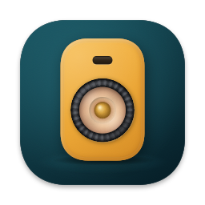
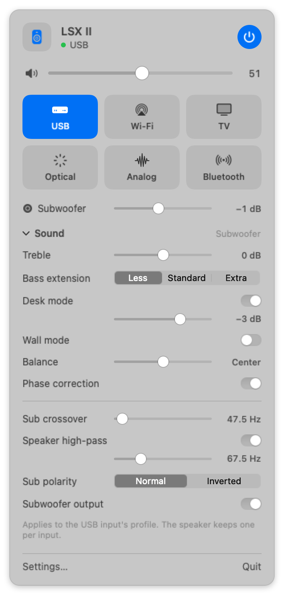
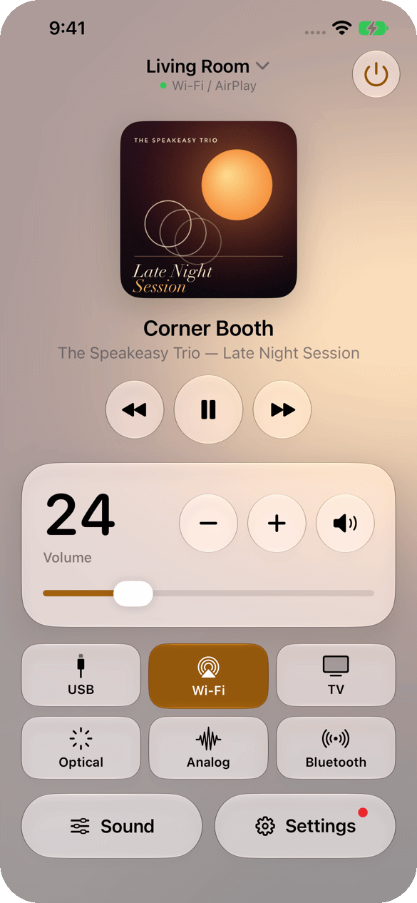
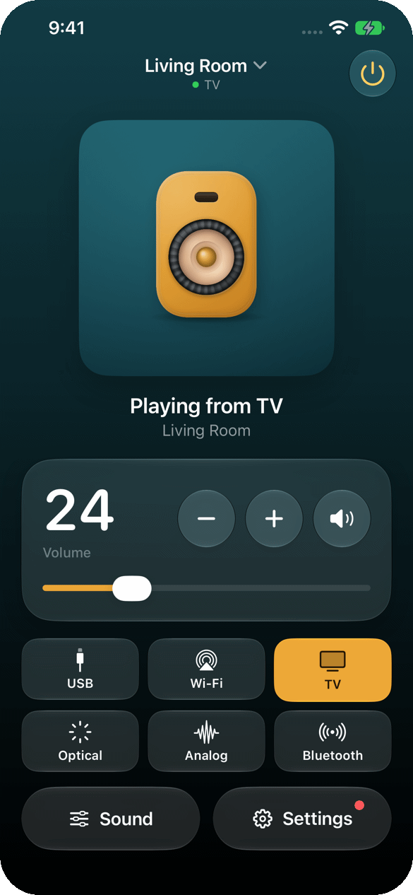
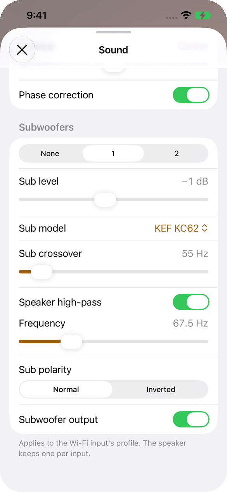
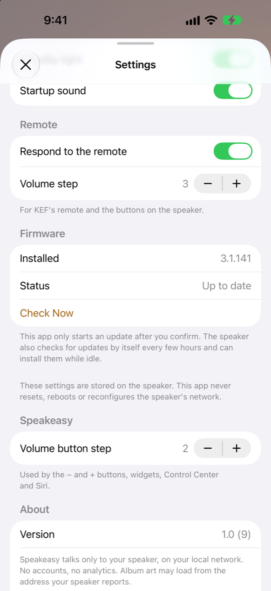
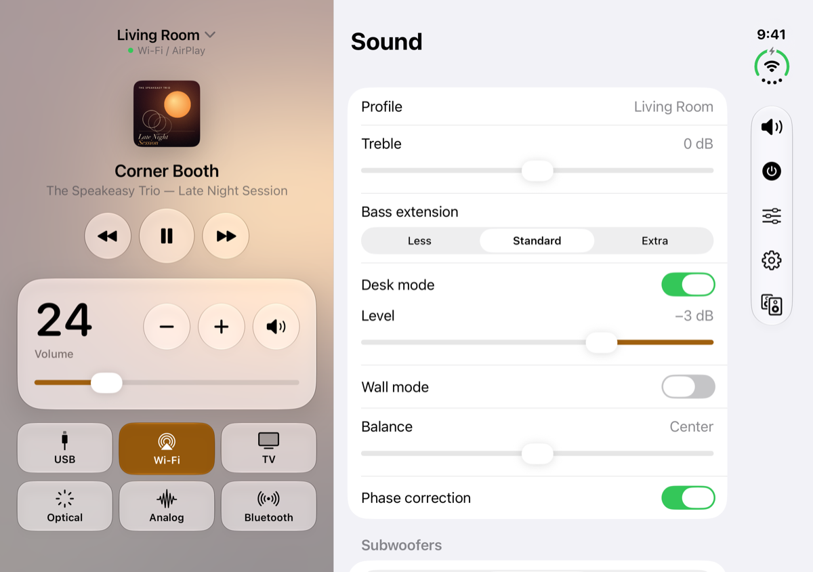
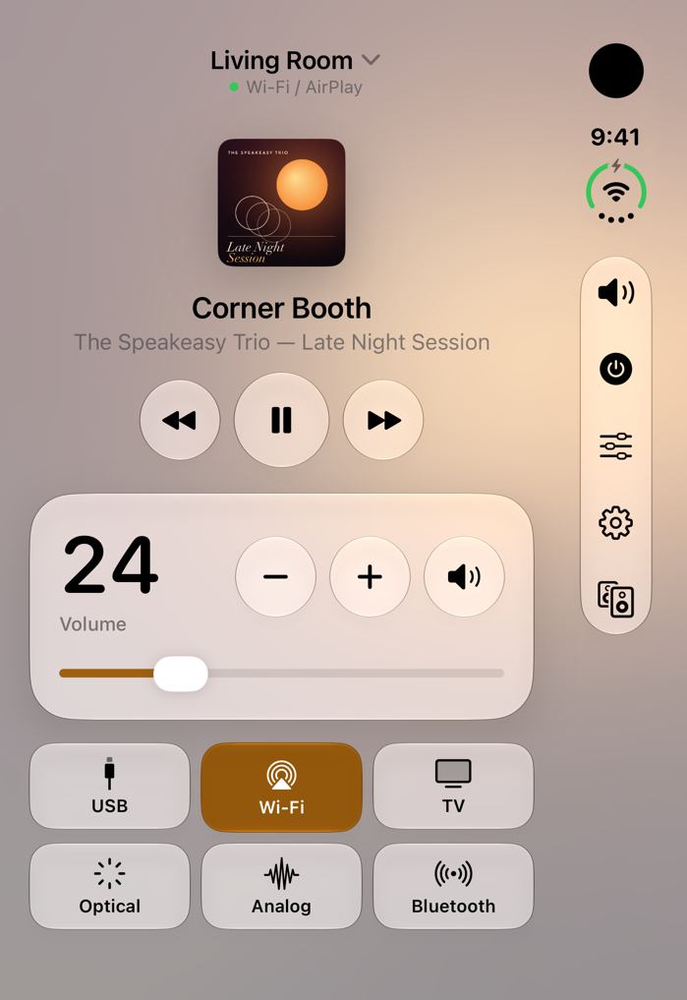
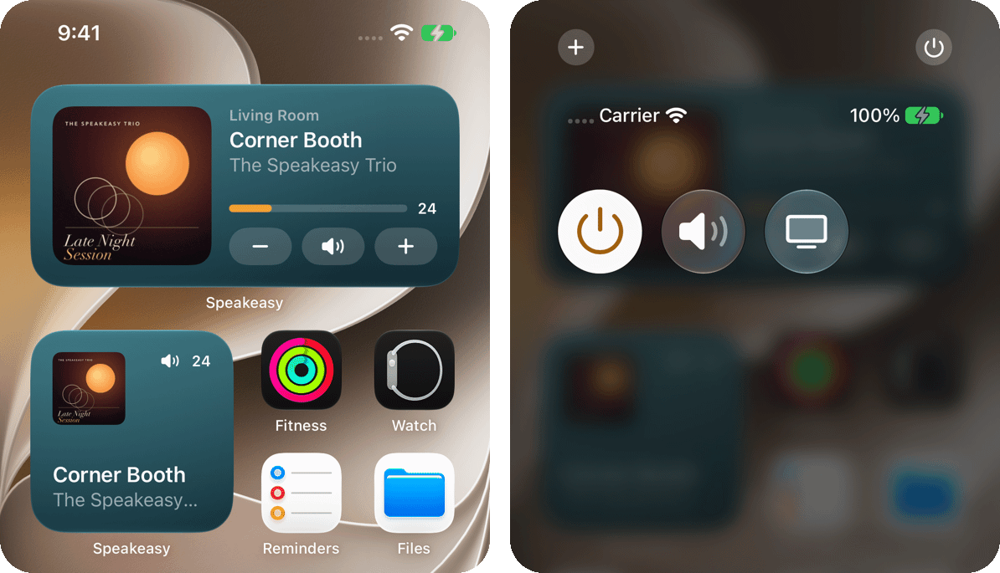
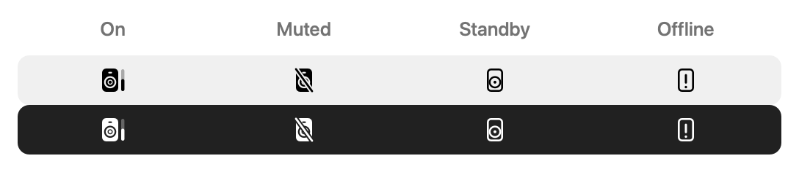

<p align="center">
  
</p>

<h1 align="center">KEF Menu Bar</h1>

<p align="center">
  Control your KEF wireless speakers from the Mac menu bar.<br>
  Volume, inputs, now playing and EQ, directly over your local network. No cloud, no account.
</p>

---

If you have KEF speakers on your desk, you've probably reached for your phone and opened
KEF Connect just to turn the volume down or switch from TV to USB. This is a small native
macOS app that puts those controls in the menu bar, with global keyboard shortcuts for
volume. There's also an [iPhone app, Speakeasy](#iphone-app-speakeasy), built on the same
code.

It talks to the speaker's own local API, the same one KEF Connect uses. Nothing goes
through KEF's servers. The only third-party code is [Sparkle](https://sparkle-project.org),
which the Mac app uses to update itself.

<p align="center">
  
</p>

> **Status:** works well every day on an LSX II (firmware 3.1.141) with a KC62 subwoofer.
> Other W2-platform models should work but are untested. Reports and PRs are welcome.
>
> Not affiliated with or endorsed by KEF. KEF and its product names are trademarks of
> their respective owners.

## iPhone app (Speakeasy)

Speakeasy is a remote for the same speakers on iPhone: power, volume, inputs and now
playing on one screen, the speaker's EQ and settings a tap away, plus Home Screen widgets,
Control Center controls and Siri. Like the Mac app, it talks straight to the speaker on your
Wi-Fi network, with no account and nothing in between.

It has been **submitted to the App Store** as *Speakeasy: Hi-Fi Remote*; the link goes here
once Apple approves it. [Website](https://zalberico.com/kef-menubar/) ·
[Support](https://zalberico.com/kef-menubar/support/) ·
[Privacy](https://zalberico.com/kef-menubar/privacy/)

<table>
  <tr>
    <td align="center" width="25%"><br><sub>Remote</sub></td>
    <td align="center" width="25%"><br><sub>TV input, dark mode</sub></td>
    <td align="center" width="25%"><br><sub>Sound</sub></td>
    <td align="center" width="25%"><br><sub>Settings</sub></td>
  </tr>
  <tr>
    <td colspan="2" align="center"><br><sub>iPhone Duo, open: remote and Sound side by side</sub></td>
    <td colspan="2" align="center"><br><sub>iPhone Duo, closed</sub></td>
  </tr>
  <tr>
    <td colspan="4" align="center"><br><sub>Widgets and Control Center</sub></td>
  </tr>
</table>

<sub>Screenshots use the app's demo mode: a made-up speaker playing a made-up album.</sub>

**Features**

- **Remote:** power, volume (slider and − / + buttons), mute, the input tiles, and now
  playing with artwork and play/pause/skip. Swipe the artwork to change tracks. Without
  artwork (on TV or optical, say) it shows the speaker instead.
- **Sound:** the same EQ as the Mac app: treble, bass extension, desk and wall mode,
  balance, phase correction, and the subwoofer section with KEF's sub presets
- **Settings:** the speaker's name, standby and wake, startup volume, volume limit, lights,
  the remote, and firmware (check, and install after you confirm)
- **Widgets and controls:** a small and a medium Home Screen widget (the medium one has
  volume buttons), Lock Screen widgets, and three controls (power, mute, input) for Control Center, the
  Lock Screen or the Action button
- **Siri and Shortcuts:** "Turn up Speakeasy", "Mute Speakeasy", "Switch Speakeasy to TV",
  "Turn on Speakeasy", plus actions for set volume, standby, play/pause and next/previous
  track
- **Several speakers:** it finds speakers with Bonjour and keeps a list of the ones you've
  used, so switching is a tap on the speaker's name. A fixed IP address works too.
- **iPhone Duo:** opened, the remote and Sound or Settings sit side by side; open or
  closed, the controls move into the vertical bar along the edge

**Install**

Speakeasy is waiting for App Store review; once it's approved, install it from the App Store.
Until then, or if you'd rather, you can build it yourself. It needs **Xcode 27.1 or later**,
and runs on **iOS 26 or later**.

1. Open `iOS/Remote.xcodeproj` in Xcode.
2. Create `iOS/Config/Local.xcconfig` (it's gitignored) with your own team and
   identifiers. The App Group has to be one your team can register:
   ```
   DEVELOPMENT_TEAM = ABCDE12345
   APP_BUNDLE_ID = com.example.Speakeasy
   APP_GROUP_ID = group.com.example.Speakeasy
   ```
3. Pick your iPhone and run the **Remote** scheme.
4. Allow **Local Network** access when asked. Without it the app can't see the speaker.
   You can turn it back on in Settings › Privacy & Security › Local Network.

**How it works:** the iPhone app shares `KEFAppCore` and `KEFKit` with the Mac app, so the
speaker model, volume rules and safety checks are the same code. The widgets and controls
live in a small extension, and they and Siri connect to the speaker just for the one action.
The app keeps a snapshot (name, volume, track, artwork) in an App Group for the widgets to
show. Apart from album art (see the [FAQ](#faq)), everything goes only to the speaker on
your local network.

## Mac features

- **Power, volume and mute**, with a live level meter right in the menu bar icon
- **Input picker:** USB, Wi-Fi / AirPlay, TV (HDMI), Optical, Analog, Bluetooth, and
  Coaxial on models that have it
- **Now playing** with artwork and play/pause/skip while streaming over Wi-Fi or Bluetooth
- **Subwoofer level**, plus a collapsible **Sound** section with the speaker's EQ: treble,
  bass extension, desk and wall mode, balance, phase correction, sub crossover, speaker
  high-pass, sub polarity and output
- **Global shortcuts:** ⌃⌥⌘↑ / ⌃⌥⌘↓ / ⌃⌥⌘M by default (all configurable), with a small
  volume overlay. Holding a volume key repeats.
- **Live updates:** changes from the remote, KEF Connect, AirPlay or anything else show up
  within a second
- **Subwoofer presets:** pick your KEF sub model (KC62, KF92, Kube…) and get KEF's default
  gain, crossover and high-pass, or restore them after tweaking
- **Speaker settings:** name, auto standby (ECO, 30, 60 minutes, never), wake source,
  switch to TV when it turns on, startup volume (one level or per input), volume limit,
  standby light, startup sound, remote on/off and volume step
- **Firmware updates:** see the installed version, check for updates on demand, and
  install one after a confirmation. The panel tells you when an update is available.
- **App settings:** Bonjour discovery or a fixed IP address, shortcut volume step and
  overlay, launch at login
- **Updates itself** with Sparkle, after asking you first (see [Updates](#updates))
- **Native and light:** SwiftUI, light and dark mode, no Dock icon, under 5 MB

The menu bar icon is a little bookshelf speaker with KEF's Uni-Q driver, not Apple's
speaker symbol, so you can tell it apart from the system volume:

<p align="center">
  
</p>

## Compatibility

| | |
| --- | --- |
| **Mac** | macOS 14 Sonoma or later, Apple silicon |
| **iPhone** | iOS 26 or later; building it needs Xcode 27.1 or later |
| **Tested** | KEF LSX II, firmware 3.1.141, with a KC62 |
| **Should work** | LSX II LT, LS50 Wireless II, LS60 Wireless (same W2 platform and API) |
| **Not supported** | The original LSX and LS50 Wireless, which use a different protocol |

The Mac or iPhone and the speaker must be on the same network.

## Install

This section is for the Mac app. For the iPhone app, see
[iPhone app › Install](#iphone-app-speakeasy).

### Download

1. Download the latest **KEF-Menu-Bar-….zip** from
   [Releases](https://github.com/zalberico/kef-menubar/releases/latest) and unzip it.
2. Move **KEF Menu Bar** to your Applications folder and open it. The app is signed and
   notarized by Apple, so macOS only asks you to confirm opening an app downloaded from
   the internet.
3. On first launch macOS asks for **Local Network** access. Allow it: the app can't reach
   the speaker without it. If you clicked Don't Allow, turn it back on in System Settings ›
   Privacy & Security › Local Network.

#### Updates

The app updates itself with [Sparkle](https://sparkle-project.org). The second time you
open it, it asks whether to check for updates automatically; you can change that later
in **Settings… › General › Updates**, and **Check for Updates…** in the panel or in
Settings checks right away. When an update is found you see what's new and choose
whether to install it. The app never downloads or installs an update without asking.

A check downloads one small file, `appcast.xml`, from the latest GitHub release. Nothing
is sent about you or your Mac: no analytics and no system profile. Each update is signed
with the project's EdDSA key, which the app checks before installing, on top of Apple's
Developer ID signature and notarization. Version 1.1.0 and earlier don't have this, so
download the first release with updates by hand.

The app finds your speaker with Bonjour. If it doesn't, open **Settings…** from the
panel and enter the speaker's IP address. You'll find the address in KEF Connect under the
speaker's settings, or in your router's client list. A DHCP reservation for the speaker is
a good idea either way.

### Build it yourself

If you'd rather build from source, it takes about a minute.

1. Install **Xcode 16 or later** from the App Store and open it once to finish setup.
2. Make Xcode the active developer directory. The Command Line Tools alone aren't enough,
   because they lack the SwiftUI macro plugins:
   ```bash
   sudo xcode-select -s /Applications/Xcode.app
   ```
3. Clone and build:
   ```bash
   git clone https://github.com/zalberico/kef-menubar.git
   cd kef-menubar
   scripts/build-app.sh --install
   ```
   This builds **KEF Menu Bar.app**, signs it, copies it to `~/Applications` and launches
   it. The script signs with your first "Apple Development" certificate if you have one and
   ad-hoc otherwise; set `CODESIGN_IDENTITY` to override.
4. Allow **Local Network** access on first launch, as above.

To update later, run `git pull` and `scripts/build-app.sh --install` again. A copy you
build yourself still offers updates from the GitHub releases, which replace it with the
released app; turn off **Automatically check for updates** if you'd rather not.

### Making a release

Push a version tag and the [Release workflow](.github/workflows/release.yml) tests and
builds the app, then publishes it as a GitHub Release:

```bash
git tag v1.0.0 && git push origin v1.0.0
```

The workflow signs the app with Developer ID and has Apple notarize it, using the secrets
listed at the top of the workflow. Without those secrets (in a fork, say) it falls back to
an ad-hoc signature, and macOS then makes people allow the app once in System Settings ›
Privacy & Security › **Open Anyway**.

With the `SPARKLE_ED_PRIVATE_KEY` secret, the workflow also signs the zip with Sparkle's
`sign_update` and attaches an `appcast.xml` for it (`scripts/make-appcast.sh`), which is
how installed copies find the update. Installed copies check this repository's latest
release, so here a tag build fails rather than publish a release without an appcast or
one that isn't signed with Developer ID and notarized. In a fork, whose releases no
installed copy checks, the release is published without an appcast, and the workflow says so.

## Using it

Click the speaker in the menu bar for the panel: power, volume, inputs, now playing, sub
level and the **Sound** section. The shortcuts work from any app. The overlay shows the
new level, and you can turn it off in Settings.

The speaker keeps a separate **volume and EQ for each input**, and the app follows that.
Switching from USB to TV gives you TV's own level and EQ. Edits apply to the input you're
on, including **Sub model** › **Restore**, which puts the sub gain, crossover and speaker
high-pass back to KEF's defaults for your subwoofer.

**Settings…** has two tabs. **General** covers the app itself: which speaker, the keyboard
shortcuts, launch at login and updates. **Speaker** covers settings stored on the speaker: name,
standby and wake, startup volume, volume limit, lights, the remote and firmware.

## Command line: `kefctl`

The repo also builds a small CLI on the same library, handy for scripts, Shortcuts or
debugging:

```bash
swift build -c release --product kefctl
K="$(swift build -c release --product kefctl --show-bin-path)/kefctl"

$K discover                        # list speakers on the network
$K 192.0.2.20 state              # name, power, input, volume, now playing…
$K 192.0.2.20 volume 30
$K 192.0.2.20 mute on
$K 192.0.2.20 source tv          # usb | wifi | tv | optical | coaxial | analog | bluetooth | standby
$K 192.0.2.20 control pause      # pause | next | previous
$K 192.0.2.20 eq                 # current input's EQ profile and allowed ranges
$K 192.0.2.20 eq-set trebleAmount -1
$K 192.0.2.20 watch 60           # print live events for 60 s (default 30)
$K 192.0.2.20 settings           # standby, wake source, startup volume, lights, remote
$K 192.0.2.20 name "Desk"        # rename the speaker
$K 192.0.2.20 firmware           # installed version and update status
$K 192.0.2.20 firmware check     # ask the speaker to look for an update (installing is app-only)
```

## FAQ

**Do I still need KEF Connect?** Only for initial setup and network changes (Wi-Fi,
pairing), and for its streaming-service browsing. Everything on KEF Connect's settings
screens that a desktop speaker needs is under **Settings › Speaker** on the Mac and
**Settings** on the iPhone, and firmware updates are there too: **Check Now** asks the
speaker to look for one, and **Update…** installs it after you confirm. The speaker then
restarts and is unreachable for a few minutes. It also checks by itself every few hours and
can install updates while idle, so you may never need the button.

**Is it safe to point at my speakers?** Both apps read state and change the same everyday
settings KEF Connect does: volume, mute, input, playback, EQ, the volume limit and the
speaker settings above. They can also ask the speaker to
check for firmware and, only after you confirm, install an update. The client library
refuses destructive paths outright, whatever calls it: factory reset, reboot, network
setup, pairing wipes and DSP restore (`KEFSafety` in `Sources/KEFKit/Paths.swift`).
Firmware paths are refused there too, except for the two actions KEF Connect itself
uses. Those are reachable only through dedicated methods, and the install one first
re-reads the speaker and refuses unless the speaker reports an update. Volume and EQ writes are held off for about 1.5 s after
an input change, so a shortcut can't apply one input's level to another.
On the iPhone, Siri, Shortcuts, the widgets and the controls only change volume, mute,
input, power and playback. Each one reads the speaker's volume limit first and never sets
the volume above it. The volume limit, firmware and everything else in Settings stay in
the app.

**Does it phone home?** No. Neither app has analytics or accounts, and both talk only to
your speaker, with two exceptions. Album art loads from whatever address the speaker
reports for the current track, sometimes a streaming service's image server. And the Mac
app's update checks, once you've allowed them or when you click **Check for Updates…**,
fetch `appcast.xml` from GitHub, which sees your IP address like any download; Sparkle's
optional system profile is turned off, so nothing else is sent.

**Multiple speakers?** The Mac app controls one speaker (a stereo pair counts as one). You
can pick which one in Settings, and the app then sticks to that speaker by its MAC address,
even if its IP address changes. The iPhone app keeps a list of the speakers it has found or
connected to, and you switch between them from the speaker's name at the top of the remote.
Its widgets, controls and Siri act on the speaker you picked last.

**Is it on the App Store?** The iPhone app has been submitted as *Speakeasy: Hi-Fi
Remote* and will be there once Apple approves it. A Mac App Store version of the menu bar
app is in the works. In the meantime the Mac releases here are signed with Developer ID,
notarized by Apple and keep themselves up to date, which is all macOS needs to open them
without a warning.

## How it works

KEF's W2 speakers expose a JSON API on the local network: `getData` / `setData` on paths
like `player:volume`, an event queue you long-poll for changes, and Bonjour advertising as
`_kef-info._tcp`. The protocol follows [pykefcontrol](https://github.com/N0ciple/pykefcontrol)
1.0.1 (MIT), which this project uses as its reference. `KEFKit` is a Swift port derived from
it (see [THIRD_PARTY_NOTICES](THIRD_PARTY_NOTICES)), and the signing tests check against
pykefcontrol's own `sign()`.

What we found on the LSX II on firmware 3.1.141:

- Only HTTPS on port 4430 is served. The certificate is issued by KEF's private CA for the
  speaker's IP addresses and regenerated at boot. The app pins that CA. Port 80 is closed,
  even though Bonjour still advertises it.
- GETs are unsigned. POSTs need an `HMAC_SHA256` authorization header, after a one-time
  `webserver:addUser` registration.
- The speaker struggles with many fresh TLS handshakes in a row, so the client keeps one
  keep-alive session.
- EQ and sub settings are read and written as one `kef:eqProfile/v2` profile. It's per
  input, and so is the volume.
- `settings:/kef/host/speakerStatus` can stay `standby` after a wake while the speaker
  plays, so on/off follows `physicalSource`.
- Errors come back as HTTP 500 with a JSON body. An expired event queue is an HTTP 400
  with plain text.
- Speaker settings are plain values under `settings:/kef/host/` (`standbyMode`,
  `wakeUpSource`, `standbyDefaultVol`, `defaultVolumeGlobal`, `disableFrontStandbyLED`,
  `startupTone`, `remote/remoteIR`, `volumeStep`…). A per-input startup volume goes
  through KEF Connect's `hostlink:defaultVolume/set` action instead. The same action with
  no input is accepted but changes nothing, so the all-inputs level is written directly.
  The app reads each startup level back after writing it. Picking a sub model in KEF Connect
  also rewrites the profile's sub gain, crossover and high-pass from per-model tables
  (they depend on a KW1 wireless kit and the number of subs).
- Firmware updates follow KEF Connect: activating `firmwareupdate:checkForUpdate` makes
  `firmwareupdate:updateStatus` report `newUpdateAvailable` with the version, and
  activating `firmwareupdate:downloadNewUpdate` downloads and installs it (progress in
  `kef:fwupgrade/info`). The [homeassistant-kef](https://github.com/EvotecIT/homeassistant-kef)
  notes on these paths were a useful reference. The install step hasn't been seen live
  here yet, because there hasn't been a newer LSX II release to install.

The client falls back to plain HTTP on port 80 for older firmware that doesn't serve 4430.

## Development

```bash
swift test                        # signing vectors, JSON, requests, transport, EQ, safety,
                                  # the shared speaker model, volume rules and commands
scripts/build-app.sh              # build and sign into build/ without installing

# The iPhone app and its widget extension (Xcode 27.1+)
xcodebuild -project iOS/Remote.xcodeproj -scheme Remote \
  -destination 'generic/platform=iOS Simulator' build
```

| Path | What |
| --- | --- |
| `Sources/KEFKit` | Protocol library: transport (HTTPS 4430 with HTTP fallback), KEF CA pinning, HMAC signing, typed values, events, EQ, Bonjour discovery. No dependencies. |
| `Sources/KEFAppCore` | What both apps share: the live speaker model, preferences, the volume rules, and the one-shot commands the widgets, controls and Siri use. |
| `Sources/KEFMenuBar` | The Mac app: menu bar extra, Settings, hot keys, volume overlay, icon drawing. |
| `Sources/kefctl` | The CLI above. |
| `Tests/KEFKitTests`, `Tests/KEFAppCoreTests` | Swift Testing suites. The tests never touch a real speaker. |
| `iOS/` | The iPhone app: `Remote.xcodeproj` (scheme **Remote**), the app (`App/`), the widget and controls extension (`Widgets/`), code both use (`Shared/`) and build settings (`Config/`). |
| `scripts/build-app.sh` | Builds, signs and optionally installs the Mac `.app`, with Sparkle embedded. |
| `scripts/make-appcast.sh` | Signs a release zip with the Sparkle key and writes its `appcast.xml`. |
| `scripts/make-icon.swift` | Renders `Resources/AppIcon.icns` from the same drawing as the menu bar icon. |
| `scripts/make-ios-icon.swift` | Renders the iPhone app icon and its speaker art into `iOS/App/Assets.xcassets`. |
| `scripts/signing_vectors.py` | Regenerates the signing test vectors from a pykefcontrol wheel. |

Debug builds of the iPhone app take a `-DemoSpeaker` launch argument: a made-up speaker,
served in-process, so nothing touches the network. The screenshots above come from it.

**Update signing key.** Sparkle checks updates against `SUPublicEDKey` in
`Resources/Info.plist`. The matching private key is in the maintainer's login keychain
(account `kef-menubar`) and in the `SPARKLE_ED_PRIVATE_KEY` repository secret. Sparkle's
tools come with the package, under `.build/artifacts/sparkle/Sparkle/bin` after
`swift package resolve`. To rotate the key:

1. `generate_keys --account kef-menubar-2` makes a new pair and prints the public key.
2. Put the new public key in `Info.plist` and release that version while the secret still
   holds the old key, so installed copies accept it.
3. Then export the new private key (`generate_keys --account kef-menubar-2 -x key.txt`),
   replace the secret with it, and delete the file.

If the private key is ever lost, installed copies can't verify new updates, and people
have to download the next release by hand once.

If you test against your own speaker, start with read-only commands (`state`, `get`,
`rows`, `watch`) before writing anything.

## License

MIT. See [LICENSE](LICENSE) and [THIRD_PARTY_NOTICES](THIRD_PARTY_NOTICES).
